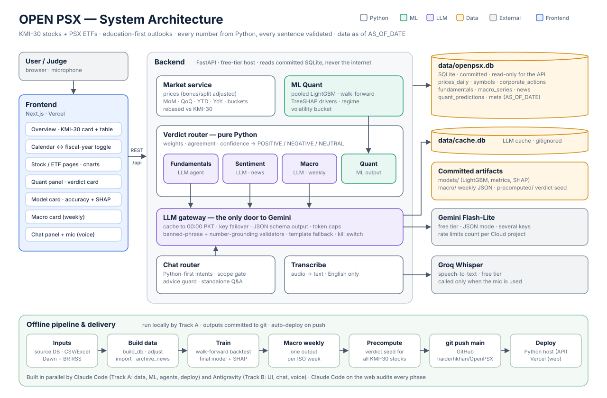

# OPEN PSX

**Education-first market intelligence for Pakistan's Shariah-compliant equities: the 30 KMI-30 stocks and 9 PSX-listed ETFs.**

OPEN PSX explains how a stock has moved and what the signals behind it say. A machine-learning quant model and three AI analyst agents feed a Python router. The router gives each stock a **POSITIVE / NEGATIVE / NEUTRAL** outlook, a confidence score, the number of signals that agree, and the reasoning. Every number comes from Python, and every AI sentence is checked against those numbers. Outlooks are educational, never trading instructions.

> Entry for the **4th AIEF AI Championship**, category **AI in Fintech**.

**Code graph:** https://haiderhkhan.github.io/OpenPSX/

---

## Why

Most retail investors in Pakistan get stock opinions from WhatsApp groups and tips, often with no data behind them. Institutional research is paywalled. What is public rarely covers Shariah-compliant stocks in a beginner-friendly way.

OPEN PSX makes the analysis transparent. It shows which signals agree, which disagree and which abstain, how confident the system is, and how weak the model's edge really is. Users learn to read the market, not to follow tips.

---

## Architecture



- **The offline pipeline** builds a read-only SQLite database with prices, KMI-30 membership, corporate actions, fundamentals, macro series and news, then trains the model. The outputs are committed to git.
- **The FastAPI backend** reads only that database and never scrapes at request time.
- **The LLM gateway** is the only code that talks to Gemini. It caches answers until midnight PKT, fails over between keys, forces JSON output and validates every reply. If a call fails, a deterministic template answers instead.

---

## Features

**Dashboard**
- KMI-30 index card, plus a sortable table of all stocks and ETFs.
- MoM, QoQ, YTD and YoY change on either a **calendar-year** or a **Pakistan fiscal-year (Jul–Jun)** basis.
- Price line and candlestick charts, return bars, and a stock vs KMI-30 overlay.
- All prices are adjusted for bonus shares and splits. These are price returns: cash dividends are not added back.

**ML Quant model**
- A pooled LightGBM classifier predicts next-week direction. It also reports a volatility bucket and the market regime.
- It is evaluated walk-forward (expanding window, retrained every 13 weeks) over 12,799 out-of-sample predictions, trained through 2026-09-18.
- **The honest result: essentially no edge.**

  | | Accuracy |
  |---|---|
  | This model (out of sample) | **51.7%** (balanced 52.0%, AUC 0.522) |
  | Baseline: repeat last week's direction | 51.5% |
  | Baseline: always the more common direction | 48.8% |

  Accuracy by year ranges from 44.6% (2019) to 53.9% (2022), with no consistent edge. KMI-30 features carry about half of the top SHAP weight, so the signal is mostly market-wide. The model page shows all of this, with SHAP drivers and every known limitation. The quant signal therefore enters the outlook at a strength equal to its own confidence, |2p − 1|, which is close to zero for a near coin-flip.

**Three AI agents + one Python verdict router**

| Signal | Type | Weight | Reads |
|---|---|---|---|
| Quant | ML model | 40% | price, volatility and KMI-30 features |
| Fundamentals | Gemini agent | 25% | EPS, P/E against the KMI-30 median, dividend yield |
| Sentiment | Gemini agent | 20% | recent headlines; **abstains when it has fewer than 3** |
| Macro | Gemini agent, weekly | 15% | policy rate, CPI, PKR/USD |

- **Weights.** The router drops abstaining signals and renormalises the weights of the rest.
- **The outlook card.** It shows the label and how many signals agree (for example, "1 of 3 signals agree").
- **Confidence.** It is capped at 60% when any agent fell back to its template, at 50% when fewer than 3 signals are active, and at 95% overall.
- **NEUTRAL.** It is shown as "Mixed signals", with no confidence figure, and a plain line saying the signals did not add up to a clear positive or negative reading.
- **ETFs** get prices and the quant model; **the KMI-30 index** is the benchmark. Neither gets an outlook card.
- **Resilience.** `LLM_ENABLED=false` is a kill switch. Every page keeps working on the committed seed and deterministic templates, and template evidence counts half, so outlooks get more cautious instead of guessing. The live demo steps are in `docs/PHASES.md` §6 step 8.

**Chatbot**
- Ask by typing or **by voice** (Groq Whisper, English).
- **Routing.** Python routes each question to a fact source: price, change, quant, outlook, macro, model or compare. The AI then phrases those facts and nothing else.
- **Refusals.** Questions outside scope (crypto, other stocks) get a fixed refusal; a question asking what to trade gets the no-advice template followed by the facts.
- **No memory.** The chatbot keeps no history: each question stands alone.

**Built for a free tier**
- AI output is cached until midnight PKT, so a repeated question costs no tokens.
- A verdict seed for all 30 stocks ships in the repo, so the demo works with no network.
- **Status badges.** Every AI sentence carries one:
  - **LIVE**: written by the AI from the numbers shown;
  - **CACHED**: the same AI text, reused from today's cache;
  - **TEMPLATE**: deterministic fallback;
  - **UNAVAILABLE**: the signal abstained.

---

## Tech stack

| Layer | Tools |
|---|---|
| Backend | Python 3.11, FastAPI, SQLite, pandas |
| ML | LightGBM, SHAP contributions, walk-forward backtest |
| LLM | Google Gemini Flash-Lite (free tier), JSON schema output |
| Speech | Groq Whisper (`whisper-large-v3-turbo`) |
| Frontend | Next.js 16 (App Router), React 19, Tailwind CSS v4, Recharts, lightweight-charts |
| Hosting | Vercel (web) + a free-tier Python host for the API (being finalised); the full app also runs on one laptop with `scripts/run_local.ps1` |

---

## Run it locally (Windows PowerShell)

You need Python 3.11, Node.js 20 or newer, and git.

```powershell
git clone https://github.com/haiderhkhan/OpenPSX.git
cd OpenPSX
py -3.11 -m venv .venv
.venv\Scripts\python -m pip install -r requirements.txt
Copy-Item .env.example .env   # optional: add GEMINI_API_KEYS and GROQ_API_KEY
powershell -ExecutionPolicy Bypass -File scripts\run_local.ps1
```

`run_local.ps1` does five things:
1. Starts the API on http://127.0.0.1:8000.
2. Writes `frontend/.env.local` if it is missing.
3. Installs the frontend dependencies and builds the frontend.
4. Serves the frontend on http://localhost:3000.
5. Opens the browser.

**Offline use.** Add `-SkipBuild` to reuse the last build with Wi-Fi off; `next/font` needs the network to build.
- With no Gemini key, outlooks come from the committed seed and other AI text comes from templates.
- With no Groq key, the mic is hidden.

**Run the pieces yourself:**

```powershell
.venv\Scripts\python -m uvicorn backend.main:app --reload --port 8000   # API docs at /docs
.venv\Scripts\python -m pytest -q                                       # offline tests: LLM mocked
cd frontend; npm install; npm run dev                                   # http://localhost:3000
```

**Configuration.** All configuration is environment variables, documented in `.env.example` and `frontend/.env.example`. Keys live only in `.env`, which git ignores.

---

## Data limitations

- **Frozen data.** Everything is as of **2026-09-23**, the as-of date shown on every page; nothing after that date is used. The PSX data source stopped serving the old scraper on 2026-09-25.
- **ETFs end earlier.** ETF prices end on **2026-08-04**, so ETF rows and pages say "Older data" and every ETF figure, including the quant model, is as of that date.
- **KMI-30 index back-fill.** Index values before **2026-04-27** are an equal-weight reconstruction from today's 30 members, chain-linked to the first real close. They are not official index closes.
- **Prices are only partly adjusted.**
  - There is no official corporate-action feed. Bonus issues and splits are inferred from one-day moves beyond ±25% (9 events).
  - Cash dividends are not adjusted, so returns are price returns, not total returns.
  - 23 one-day drops of 11–25% were left unadjusted, because they may be dividends; they await official verification.
- **Survivorship bias.** The model is trained on today's KMI-30 members and listed ETFs only. Stocks that left the index or were delisted are missing, which flatters any backtest.
- **Thin side data.**
  - Macro history has one reading per series, so the four macro features are left out of the model.
  - No stock yet has the 3 in-window headlines that sentiment needs, so the sentiment signal abstains on every outlook.
  - Fundamentals are one trailing-twelve-month snapshot (2026-07-31).

---

## Project layout

```
backend/     FastAPI app: api/, agents/ (LLM gateway + 3 agents), routing/ (verdict + chat), ml/, voice/, tests/
frontend/    Next.js app: src/app (pages), src/components, src/lib/api.ts
scripts/     offline pipeline: build data, train, weekly macro, precompute, warm, run_local.ps1
data/        openpsx.db (committed, read-only), models/, macro/, precomputed/ verdict seed
docs/        PRD, architecture, schema, rules, phases, decisions log
```

**[Interactive code graph](https://haiderhkhan.github.io/OpenPSX/)** (GitHub Pages) and [`graphify-out/GRAPH_REPORT.md`](graphify-out/GRAPH_REPORT.md) are auto-generated maps of the code.

---

## Disclaimer

OPEN PSX is an **educational tool**. Its outlooks are generated by models and AI from historical data. They are not investment advice, not a signal to trade any security, and not price predictions. Market data may be delayed or incomplete. Do your own research, or consult a licensed financial adviser, before making any investment decision.

---

## Author

**Haider Hasan Khan**, BS Accounting & Finance, FAST-NUCES Lahore ·
[GitHub](https://github.com/haiderhkhan) · [LinkedIn](https://linkedin.com/in/haider-hasan-khan-hh1100114)

Built with Claude Code and Antigravity as coding agents; Claude Code on the web audited every phase.

## License

[MIT](LICENSE)
