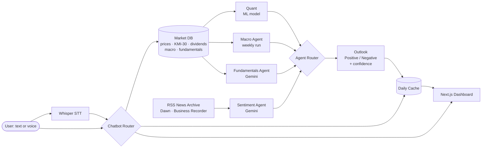

# OPEN PSX

**AI-powered market education for Pakistan's Shariah-compliant equities.**

OPEN PSX helps retail investors understand the KMI-30 stocks and PSX-listed ETFs. It combines a machine-learning quant model with three AI analyst agents, and each stock gets a plain-language **Positive / Negative outlook** with a confidence score and the reasoning behind it. There are no buy or sell calls. The goal is to teach users *why* a stock looks the way it does.

> 🏆 Entry for the **4th International AI Championship (AI Showdown)** by AIEF, held at FAST-NUCES Lahore. Category: **AI in Fintech**.

> 🚧 **Status: active development.** The backend is being migrated from an earlier prototype ([PSX War Room](#prior-work)). See the [Roadmap](#roadmap) for what is built and what is planned.

---

## Why

Most retail investors in Pakistan get stock opinions from WhatsApp groups and tips, often without any data behind them. Institutional research is paywalled, and what is public rarely covers Shariah-compliant stocks in a beginner-friendly way.

OPEN PSX makes the analysis transparent. Every outlook shows which signals agreed, which disagreed, and how confident the system is. Users learn to read the market rather than follow it.

---

## How it works



### The four analysts

| Analyst | Type | What it does |
|---|---|---|
| **Quant** | ML model | Predicts next-week return direction, volatility / risk level, and market regime. Backtest accuracy and SHAP feature importance are shown to the user. |
| **Macro** | AI agent (weekly) | Reads the policy rate, CPI, and PKR/USD. Runs once a week and serves the same view all week. |
| **Fundamentals** | AI agent (live) | Interprets EPS, P/E, and revenue trends for the selected stock. |
| **Sentiment / News** | AI agent (live) | Scores recent headlines from Dawn and Business Recorder. |

### The two routers

- **Agent Router.** Merges the four analysts into one verdict. Confidence combines the ML model's output with how strongly the agents agree, and conflicting or low-quality signals are capped or excluded.
- **Chatbot Router.** Sends each user question to the right data or agent output. Anything outside scope (KMI-30 stocks, PSX ETFs, Quant and Macro outputs, price data) gets a clear "can't answer that" response.

---

## Codebase knowledge graph

An auto-generated map of the codebase (modules, key functions, and how they connect), built with Graphify.

- [Graph report](graphify-out/GRAPH_REPORT.md)

> Generated from `backend/`, `scripts/` and `frontend/src/`. Refreshed at the final release tag.

---

## Features

**Dashboard**
- Coverage: all **KMI-30** constituents plus all **PSX-listed ETFs**
- YoY, QoQ, MoM, and YTD change, with a toggle between **calendar year** and **Pakistan fiscal year (Jul–Jun)**
- Price line and candlestick charts, % change bars, and a stock vs KMI-30 overlay

**Chatbot**
- Ask in text or **by voice** (Whisper speech-to-text, English)
- Each question is answered on its own, grounded only in OPEN PSX data

**Built for a free tier**
- Agent outputs are generated on first request and **cached until midnight**, so repeat questions cost no tokens
- If the Gemini quota runs out, the system falls back to **deterministic template answers** instead of failing
- Output guardrails reject trade instructions and price-target language, with one corrective retry per agent

---

## Tech stack

| Layer | Tools |
|---|---|
| Backend | Python, FastAPI |
| Frontend | Next.js |
| LLM | Google Gemini (free tier) |
| ML | scikit-learn / gradient boosting, SHAP |
| Speech | Whisper via a hosted API (e.g. Groq) |
| Data | SQLite, multi-source historical data, RSS news archive |

---

## Project structure

```
OpenPSX/
├── backend/
│   ├── agents/          # specialist agents, output schema, router (moderator), model config
│   └── data/            # data access, news feed, fixtures (temporary)
├── _legacy_reference/   # original Streamlit prototype, kept for reference only
├── COPIED_FROM_V1.md    # migration log: what was reused and what changes next
├── .env.example
└── LICENSE
```

---

## Getting started

> The backend is mid-migration. Setup steps below will be finalized along with `requirements.txt`.

```bash
git clone https://github.com/haiderhkhan/OpenPSX.git
cd OpenPSX
cp .env.example .env     # then add your GEMINI_API_KEY
```

Run all backend modules from the repository root so the `backend.*` imports resolve.

---

## Roadmap

- [x] Reuse and refactor agent layer from the prototype (schema, router, macro, fundamentals)
- [x] New repo structure with `backend.*` package imports
- [ ] Update output schema to Positive / Negative labels and education-friendly wording
- [ ] Replace mock data with the new SQLite market database
- [ ] RSS news archive (Dawn, Business Recorder)
- [ ] Quant ML model with backtest and SHAP explanations
- [ ] Agent Router: confidence from ML output plus agent agreement
- [ ] Daily cache and quota-exhausted fallback
- [ ] FastAPI endpoints
- [ ] Next.js dashboard (KMI-30 + ETFs, period-change views, charts)
- [ ] Chatbot with Whisper voice input
- [ ] Deployment, plus a local backup for the live demo

---

## Prior work

OPEN PSX builds on **PSX War Room**, an earlier prototype of mine that covered three stocks with a Streamlit interface and OpenAI Agents SDK specialists. OPEN PSX keeps the strongest ideas from that prototype (strict output contracts, data injection instead of tool-calling, and moderator-style aggregation). It expands coverage to the full KMI-30 and PSX ETFs, adds an ML quant model, and replaces the UI with a FastAPI + Next.js stack.

---

## Disclaimer

OPEN PSX is an **educational tool**. Its outlooks are not investment advice, recommendations, or price predictions. Market data may be delayed or incomplete. Always do your own research or consult a licensed financial advisor before making investment decisions.

---

## Author

**Haider Hasan Khan**, BS Accounting & Finance, FAST-NUCES Lahore

[GitHub](https://github.com/haiderhkhan) · [LinkedIn](https://linkedin.com/in/haider-hasan-khan-hh1100114)

## License

[MIT](LICENSE)
