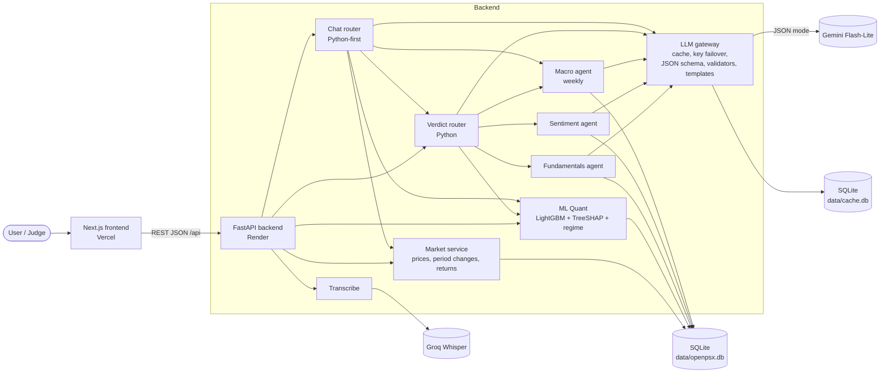
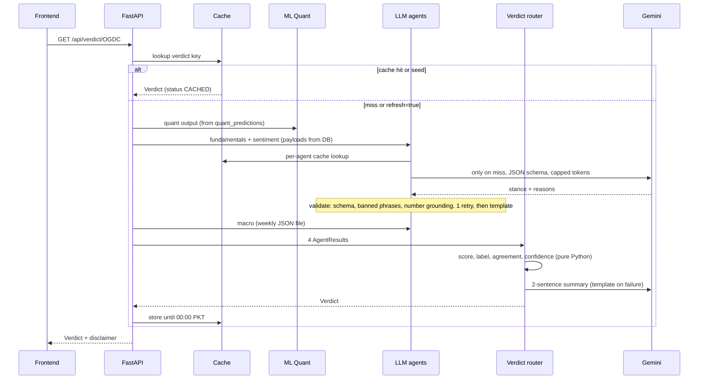
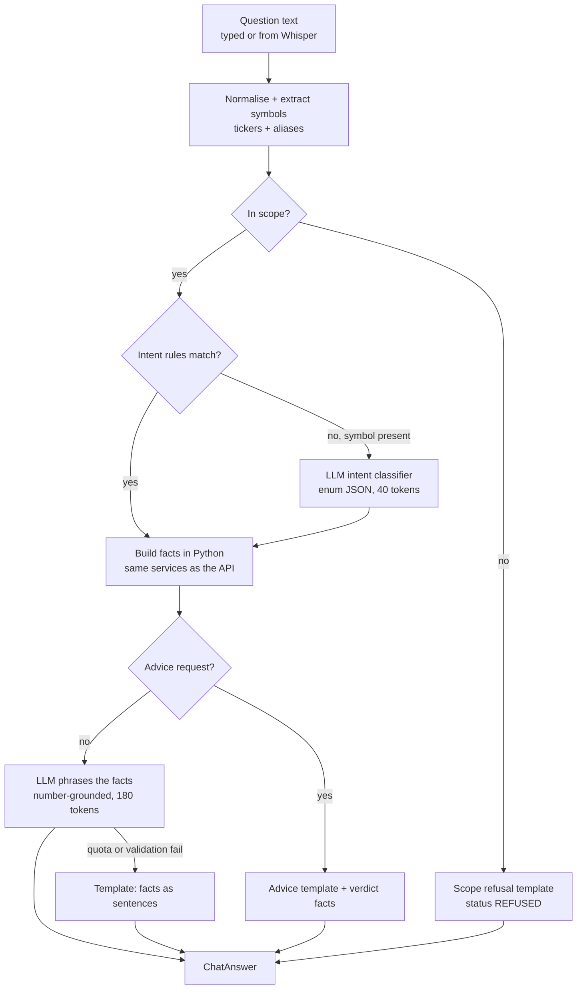
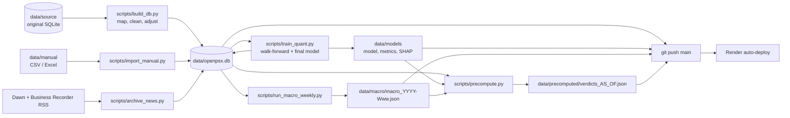
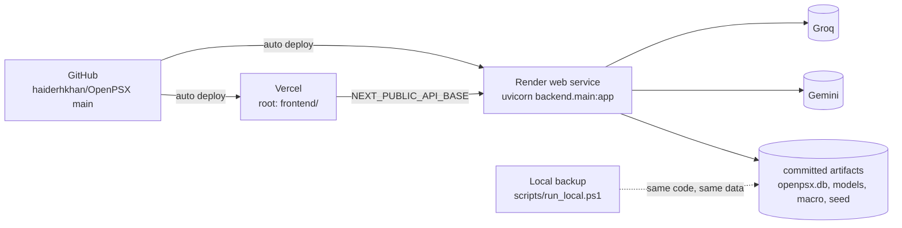
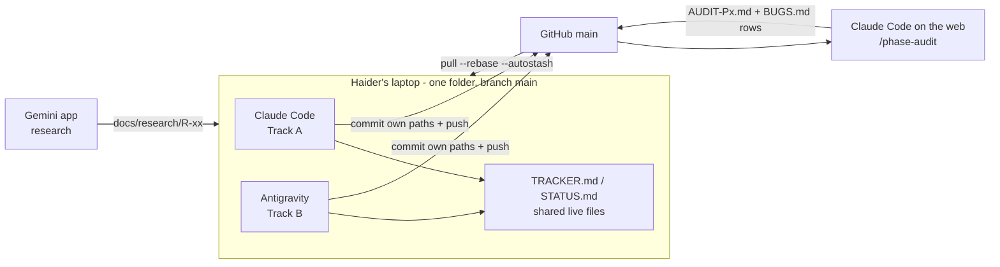

# ARCHITECTURE.md — OPEN PSX

> **How** the system works. Shapes and formulas → `SCHEMA.md` · rules → `RULES.md` · tasks → `IMPLEMENTATION_PLAN.md`.
> Visual version for the pitch and README: `docs/architecture.svg`.

## 1. Design principles
1. **Python owns every number. The LLM owns only the words.** The LLM never computes or invents a figure; a validator checks every number it writes.
2. **Deterministic first, LLM second.** Both routers, the confidence score and all fallbacks are plain Python. The system works fully with `LLM_ENABLED=false`.
3. **As-of everything.** One frozen `AS_OF_DATE` (the last clean price date) governs every query, feature, headline and label.
4. **Cache-first, quota-safe.** Precomputed seed → cache until midnight PKT → key failover → template.
5. **Contract-first parallel build.** API shapes are fixed in P0-04, so Track B builds against fixtures while Track A builds the real endpoints.
6. **Commit the artifacts.** Render's disk is ephemeral, so the DB, model, macro JSON and seed verdicts all ship in git.

## 2. System overview


## 3. Components
| Component | Path | Built in | Notes |
|---|---|---|---|
| App + router registration | `backend/main.py` | P0-04 | Registers `market`, `insights`, `chat` routers once and calls `startup.on_startup()`; nobody edits it after P0-04 |
| Startup hook | `backend/startup.py` | P0-04, P6-07 | Loads the precomputed seed into the cache |
| Config | `backend/config.py` | P0-04 | Env, feature flags, paths, verdict weights and thresholds |
| Contracts | `backend/schemas/` | P0-04 | Pydantic v2 models from `SCHEMA.md` §4 |
| DB access | `backend/db/` | P2-03 | `schema.sql`, `connection.py` (read-only connections for the API), `queries.py`, `adjust.py` |
| Period analytics | `backend/analytics/periods.py` | P2-06 | `SCHEMA.md` §5 |
| Market API | `backend/api/market.py` | P2-06 | Endpoints 1–7 |
| ML Quant | `backend/ml/` | P4 | `features`, `train`, `backtest`, `explain`, `regime`, `predict` |
| Insights API | `backend/api/insights.py` | P4-04, P6-06, P6-07 | Endpoints 8–11 |
| LLM gateway | `backend/agents/llm.py` | P6-01 | **The only place `google.genai` is imported** |
| Validators | `backend/agents/validators.py` | P6-02 | Schema, banned phrases, number grounding, retry → template |
| Cache | `backend/cache/cache.py` | P6-03 | `SCHEMA.md` §8 |
| Agents | `backend/agents/{fundamentals,sentiment,macro}.py` + `prompts/*.md` + `lexicon.py` | P6-04…06 | `SCHEMA.md` §9 |
| News ingest | `backend/ingest/news.py`, `scripts/archive_news.py` | P6-05 | RSS runs only in the script, never in a request |
| Verdict router | `backend/routing/verdict_router.py` | P6-07 | `SCHEMA.md` §9 maths |
| Chat router + answer | `backend/routing/chat_router.py`, `chat_answer.py`, `backend/api/chat.py` | P7-01, P7-02 | `SCHEMA.md` §10 |
| Voice | `backend/voice/transcribe.py` | P7-03 | Groq OpenAI-compatible transcription API, English |
| Frontend | `frontend/` | P1, P3, P5, P7, P9 | Next.js App Router, TS, Tailwind, shadcn/ui, lightweight-charts, Recharts |
| Offline jobs | `scripts/` | P2, P4, P6, P8 | Run locally by Track A; their outputs are committed |

## 4. Verdict request flow


## 5. Chat flow


## 6. Offline data and artifact pipeline (local, Track A)


## 7. Cost and quota design (Gemini free tier, Flash-Lite)
| Layer | What it saves |
|---|---|
| **Precomputed seed** (P8-01) | Browsing all 30 stocks costs **0 tokens** |
| **Cache until 00:00 PKT** | Repeat questions or pages cost 0 tokens; macro is cached per ISO week |
| **Python-first routing** | No LLM call to route the verdict or most chat questions |
| **Compact payloads** | Canonical JSON with only the needed fields; short prompt files; `max_output_tokens` caps (`SCHEMA.md` §9) |
| **JSON schema output** | No parsing retries; minimal thinking (`thinking_level="minimal"` on 3.x, `thinking_budget=0` on 2.5; D-41) |
| **Key failover** | On 429 → next key in `GEMINI_API_KEYS`. Only keys from **separate projects** add quota. |
| **Soft cap + kill switch** | `LLM_DAILY_CALL_LIMIT`, `LLM_ENABLED=false` → templates |

Rough budget: one live verdict = 3 agent calls + 1 summary = 4 calls (macro comes from the weekly file). One chat = 1–2 calls.

## 8. Failure modes
| Failure | Behaviour |
|---|---|
| Gemini 429 / quota exhausted | Failover → template, `status: TEMPLATE`, confidence capped at 0.60 |
| LLM returns invalid JSON / banned phrase / ungrounded number | 1 retry with the error → template |
| Groq down / audio too long | `503 UPSTREAM` / `400 BAD_REQUEST`; UI keeps the text box usable |
| Symbol outside the universe | `NOT_IN_SCOPE` (API) or refusal template (chat) |
| Missing history for a period | That `Change.pct` is `null`; UI shows "—" |
| Render cold start | `scripts/warm.py` before the demo; local backup on the laptop |
| Render restart wipes `cache.db` | Seed reload at startup |
| Feature dropped | Flag off → endpoint returns `FEATURE_OFF`; UI hides the control |

## 9. Deployment

- **Render (free):** idles to sleep (cold start on the next request) and its disk is ephemeral. Health check path is `/api/health`. Python is pinned to 3.11. Keys are set as env vars in the dashboard.
- **Vercel:** root directory `frontend/`. Env vars: `NEXT_PUBLIC_API_BASE` (Render URL) and `NEXT_PUBLIC_USE_MOCKS=false`.
- **CORS:** `CORS_ORIGINS` = localhost + the Vercel production URL.

## 10. Development workflow (two agents + cloud auditor)


## 11. Repo layout (target after P0-01)
```
OpenPSX/
├── AGENTS.md  CLAUDE.md  TRACKER.md  STATUS.md  BUGS.md  README.md (P9-02)
├── .gitignore  .gitattributes  .env.example  requirements.txt  pytest.ini  render.yaml (P8-02)
├── .claude/commands/         start-task.md  finish-task.md  phase-audit.md
├── .agents/workflows/        start-task.md  finish-task.md
├── docs/
│   ├── PRD.md  ARCHITECTURE.md  SCHEMA.md  RULES.md  PHASES.md  IMPLEMENTATION_PLAN.md  MEMORY.md
│   ├── architecture.svg
│   ├── research/             R-01…R-05, SOURCE_DB.md, AIEF_PROPOSAL.md
│   └── audits/               AUDIT-P0.md …
├── contracts/fixtures/       one JSON per endpoint (SCHEMA.md §4.2)
├── backend/
│   ├── main.py  startup.py  config.py
│   ├── schemas/              common.py  market.py  insights.py  chat.py
│   ├── api/                  market.py (A)  insights.py (A)  chat.py (B)
│   ├── db/                   schema.sql  connection.py  queries.py  adjust.py
│   ├── analytics/            periods.py
│   ├── ml/                   features.py  train.py  backtest.py  explain.py  regime.py  predict.py
│   ├── agents/               llm.py  validators.py  lexicon.py  fundamentals.py  sentiment.py  macro.py  prompts/
│   ├── routing/              verdict_router.py (A)  chat_router.py (B)  chat_answer.py (B)
│   ├── cache/                cache.py
│   ├── ingest/               news.py
│   ├── voice/                transcribe.py (B)
│   └── tests/                conftest.py  test_*.py
├── scripts/                  inspect_source.py  build_db.py  import_manual.py  make_fixture_db.py  train_quant.py
│                             archive_news.py  run_macro_weekly.py  precompute.py  warm.py  smoke.py  run_local.ps1
├── data/
│   ├── openpsx.db (committed)   cache.db (ignored)   source/ (ignored)
│   └── universe/  manual/templates/  models/  macro/  precomputed/
├── frontend/                 Next.js app — src/app, src/components, src/lib (api.ts, types.ts), src/mocks
├── graphify-out/             GRAPH_REPORT.md committed; everything else ignored
└── _legacy_reference/        v1 Streamlit app + v1_backend/ (read-only reference, excluded from graphify)
```

## 12. Security and compliance
- No secrets in git. `.env` and `frontend/.env.local` are gitignored; their `.env.example` files are committed.
- The API is read-only for users. The only writes are to `cache.db`. The SQLite DB is opened read-only by API handlers.
- Groq audio is sent only when the user taps the mic. Nothing is stored server-side.
- Every outlook shows the disclaimer (`SCHEMA.md` §7). Advice language is blocked at the validator and swept in every audit.
