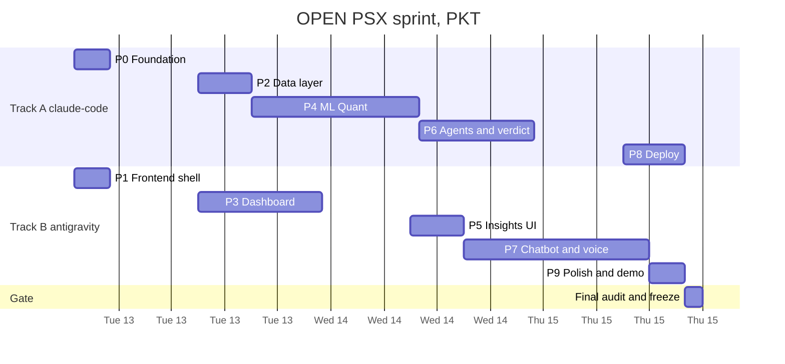

# PHASES.md — what by when

> Two parallel tracks. Each phase is owned by one tool, and two phases run at the same time.
> Windows are **wall-clock PKT**, not effort. Haider's time is 4–6 h/day; the agents run while he supervises.
> Task lists: `docs/IMPLEMENTATION_PLAN.md` · Live status: `TRACKER.md`.

## 1. Timeline

| Day | Track A — claude-code | Track B — antigravity | Haider |
|---|---|---|---|
| **Mon 12 Oct** eve | P0 Foundation | P1 Frontend shell (P1-03 after P0-04) | H-01, H-02, H-05; start H-03 |
| **Tue 13 Oct** | P2 Data → P4 ML Quant | P3 Dashboard (mocks, then live after P2-06) | H-03 done by 09:00; audits A-P0, A-P1, A-P2 |
| **Wed 14 Oct** | P4 finish → P6 Agents + verdict | P5 Insights UI → P7 Chatbot | H-04 done by 09:00; audits A-P3, A-P4, A-P5 |
| **Thu 15 Oct** | P8 Deploy (start by 12:00 at the latest) | P7 finish → P9 Polish | H-07 by 09:00; audits A-P6, A-P7; G-01; H-09 |

## 2. Why the tracks don't collide
- **Contract-first.** P0-04 freezes every API shape and writes fixtures. Track B builds UI against mocks the whole time.
- **File ownership** is listed in `RULES.md` R-03. Track B touches backend Python only in P7 (chat and voice files), which Track A never edits.
- `backend/main.py` registers all routers in P0-04, so nobody edits it again.

## 3. Phases and exit criteria
| Phase | Owner | Window | Goal | Exit criteria (all must hold) |
|---|---|---|---|---|
| **P0 Foundation** | A | Mon 19–23 | Clean repo, contracts, stubs | Layout per `ARCHITECTURE.md` §11; `pip install -r requirements.txt` works on Windows + Linux; all 13 endpoints return their fixture; `pytest -q` green; graphify baseline committed |
| **P1 Frontend shell** | B | Mon 19–23 | Next.js app on mocks | `npm run build` green; 4 routes render in mock mode; typed client for all 13 endpoints; disclaimer + "Data as of" in the shell |
| **P2 Data layer** | A | Tue 09–15 | Real data + market API | `data/openpsx.db` built and committed; `AS_OF_DATE` set; bonus/split adjustment tested; endpoints 1–7 live; period tests (calendar + fiscal) green |
| **P3 Dashboard** | B | Tue 09–23 | Overview + stock pages | Overview, charts, return bars, overlay and basis toggle working **against the live API** |
| **P4 ML Quant** | A | Tue 15 → Wed 10 | Model + explainability | Look-ahead test green; walk-forward metrics + baselines in `quant_metrics.json`; SHAP global + per-symbol; endpoints 8–9 live |
| **P5 Insights UI** | B | Wed 09–15 | Quant, model, verdict, macro UI | Quant panel, model page, verdict card, macro card render (mock or live) with status badges + disclaimer |
| **P6 Agents + verdict** | A | Wed 10–23 | LLM layer | `llm.py` sole importer of `google.genai`; validators + cache tested; 3 agents with templates; verdict maths tested; endpoints 10–11 live; app works with `LLM_ENABLED=false` |
| **P7 Chatbot + voice** | B | Wed 15 → Thu 12 | Chat end-to-end | ≥ 25 router tests green; `/api/chat` and `/api/transcribe` live; chat panel with mic on every page |
| **P8 Deploy** | A | Thu 09–16 | Public + backup | Seed for all KMI-30; Vercel backend + frontend live (D-71); smoke test passes on the public URL; `run_local.ps1` works |
| **P9 Polish + demo** | B | Thu 12–16 | Demo quality | No console errors; all states handled; README + About + architecture image; demo script (§6) run twice on the deployed URL |
| **Gate** | A + H | Thu 16–18 | Freeze | G-01 audit has 0 open CRITICAL; tag `v1.0-demo` pushed |

After each phase, Haider runs the cloud audit (`/phase-audit P<n>`, rows A-P0…A-P9). CRITICAL findings are fixed by the owning track before its next task.

## 4. Checkpoints and drop rules
At each checkpoint, Haider (or whichever agent is active) compares `TRACKER.md` with the condition below. If it's missed, apply the drop by flipping its flag, and record it in `STATUS.md` + `MEMORY.md`. Drops are flag flips (`SCHEMA.md` §11), never deletions.

| Checkpoint | Condition | If missed → drop |
|---|---|---|
| **C1 — Tue 13 Oct 23:00** | P2 `DONE`, P3-01…P3-03 `DONE`, P4-01 `DONE` | **#1 ETF coverage** (`FEATURE_ETFS=false`; ETFs stay on the dashboard only if their prices are already in the DB) |
| **C2 — Wed 14 Oct 23:00** | P4 `DONE`, P5 `DONE`, P6-01…P6-05 `DONE`, P7-01 `DONE` | P6-06 not done → **#2 Macro LLM** (`FEATURE_MACRO_LLM=false`). The fiscal toggle not working end-to-end → **#3 fiscal toggle** (`FEATURE_FISCAL_TOGGLE=false`) |
| **C3 — Thu 15 Oct 12:00** | P6 `DONE`, P7-01…P7-03 `DONE` | Voice not working end-to-end → **#4 Whisper** (`FEATURE_VOICE=false`). **P8-02 starts at 12:00 regardless.** |
| **Freeze — Thu 15 Oct 18:00** | §5 checklist all ticked | Anything unfinished → `DROPPED` in `TRACKER.md`, listed in `STATUS.md` |

## 5. Demo-ready checklist (Definition of Done for 15 Oct)
- [ ] Vercel URL opens the overview in under 3 s after `scripts/warm.py`
- [ ] Vercel backend `/api/health` OK; warm-up procedure written in `STATUS.md` (Render never deployed, D-71)
- [ ] All KMI-30 stock pages show the chart, changes, Quant panel and verdict (seeded or live)
- [ ] ETF pages show the chart, changes and Quant panel (unless drop #1)
- [ ] Model page shows walk-forward accuracy vs both baselines, plus SHAP
- [ ] Calendar ↔ fiscal toggle changes YTD and the year/quarter buckets (unless drop #3)
- [ ] Chatbot: the 10 scripted questions (§6) answered; 3 out-of-scope refused; 1 advice request handled with the education framing
- [ ] Voice: mic → transcription → answer in Chrome on the demo laptop (unless drop #4)
- [ ] `LLM_ENABLED=false` → every page still works on templates
- [ ] Local backup: `scripts/run_local.ps1` runs the full app on the laptop
- [ ] Disclaimer visible on every outlook surface; 0 banned phrases (audit sweep)
- [ ] README + `docs/architecture.svg` on GitHub
- [ ] G-01: 0 open CRITICAL bugs

## 6. Demo script (≈ 5 min, rehearsed in P9-03 and H-09)
1. **Overview.** KMI-30 card + table. Toggle calendar → fiscal: YTD changes. *Pakistan's fiscal year, built in.*
2. **A large-cap stock page.** Candles → return bars → overlay vs KMI-30.
3. **Quant panel.** Probability, volatility bucket, regime, top drivers. *Explainable, not a black box.*
4. **Model page.** Walk-forward accuracy vs baselines. *We show the honest number.*
5. **Verdict card.** Four agents, agreement and confidence, then "Refresh live" for OGDC. *Python decides; the LLM only explains.* A live refresh takes about 5–20 s; a Gemini 503 costs one 2 s retry. After it, the button rests for a minute (the API allows one refresh a minute per stock).
6. **Chat by voice.** "What is the market regime right now?" Then "How has <stock> done this fiscal year?"
7. **Guardrails.** "Should I buy <stock>?" → education framing. "What about Tesla?" → scope refusal.
8. **Resilience (live, ≈ 60 s; always the last step).** *If the AI goes down, the numbers stay.* Checked against the local backend on 2026-10-20 (FIX-03):
   1. In the **OPEN PSX backend :8000** window: `Ctrl+C`, then `$env:LLM_ENABLED = 'false'; .venv\Scripts\python -m uvicorn backend.main:app --host 127.0.0.1 --port 8000`. The frontend keeps running.
   2. Open `/stock/HUBC`, **not** the stock refreshed in step 5: that one keeps today's LIVE fundamentals row until midnight, so only its summary would change (P9-03 rehearsal, G-30). The seeded outlook still shows (POSITIVE 23%, badges CACHED). *Precomputed outlooks survive an outage.*
   3. Click **Refresh live**: the fundamentals row and the summary turn **TEMPLATE**, and the outlook becomes NEUTRAL: "Overall outlook: NEUTRAL (no confidence figure for a neutral reading). 1 of 3 signals agree." *Template evidence counts half (§9 k = 0.5), so the outlook gets more cautious instead of guessing.*
   4. Chat "How has HUBC done this year?" (a question not asked earlier today, or it comes back CACHED): the answer is **TEMPLATE**, with the same numbers as the page.
   5. Show the architecture image. Afterwards: `Ctrl+C`, `$env:LLM_ENABLED = 'true'`, and the same uvicorn line. For 15 min after this, a refresh of HUBC can still show the cached TEMPLATE fundamentals row; plain page reads are back on the seed at once.

Scripted chat questions (for the checklist):
- What is the market regime right now?
- How has OGDC done this fiscal year?
- What is the latest policy rate?
- How accurate is your model?
- What drives the model's view on MEBL?
- Compare LUCK vs KMI-30 this year.
- What's the overall outlook for HUBC?
- Which ETFs do you cover?
- What was ENGRO's closing price on the as-of date?
- Is volatility high for PPL?

Swap tickers for any that aren't in the frozen KMI-30 list.

## 7. After 15 Oct (only if shortlisted on 16 Oct)
**P10 Polish for the final (16–23 Oct):** mentor feedback, pitch deck, screenshots, a 90-second backup video, a paid-tier decision, more data. These are planned in a new section of `IMPLEMENTATION_PLAN.md` at that point.
